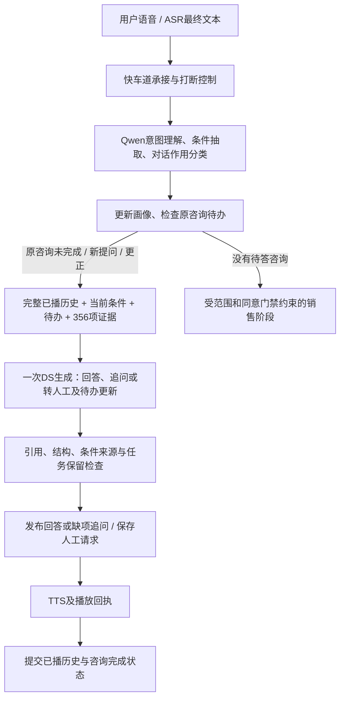

# 持续咨询待办与条件追问验证

更新于2026-10-13。按用户要求，`EvidencePipeline`默认接入v4持续咨询：原咨询没有完成，补年龄、医保或更正条件都继续处理原咨询，答完后才允许推进销售。完整已播历史及仅在服务端上下文超限时摘要的策略保持不变。

2026-10-14后续开发：历史待办重列已增加本轮原话校验、原ID复用和依赖条件更正控制；124项本地回归及5个真实模型规划用例通过，见[专项修复记录](29-当前问项与历史待办隔离.md)。下面exp44语音失败仍保留为历史实测，本轮没有重跑完整语音来宣告该失败已通过。

2026-10-14补充：当前代码增加主模型等待期间的一次小模型主题承接，并在[新版整体复验与等待承接](28-新版整体复验与等待承接.md)中完成143题文字及连续语音复验。最新语音链路仍发现一个现实问题：历史复合咨询中的部分待办会被当前问题规划重复生成，导致某轮进入“待办异常”安全兜底；之后转人工时旧待办仍保留。该问题已记录为当前待修项，旧30例50轮和90项回归数据仍只代表当时版本。

## 解决的问题

之前“她有医保”通常被分类为提供信息，随后程序销售流程只报年/月价，原来问的全年差额、优惠容易丢失。现在会话独立保存原问题及全部待答问项，条件补充直接回到证据回答模型。咨询完成这一轮不再追加一遍报价或投保链接，后续用户交互才恢复销售。

“假设”指用户没有确认、为了演示临时设定的条件，例如用户只说合规费用15000元、没走医保，模型自行设定“以有医保身份投保、年度免赔还剩10000元”。未走医保是结算行为，不等于保单投保身份；年度免赔总额也不等于当前剩余额。实际金额缺必要条件时先问；用户明确要求举例、公式或假设场景时，仍可在明确前提下解释。

之前允许完整条件分支或假设示例，是为了在介绍规则时少问无关条件、直接提供有用解释。问题出在把介绍规则和回答用户实际金额混在了一起。v4保留一般规则解释，但不再以某个未确认假设算完就宣布实际咨询完成。

## 待办如何保存

`CallSession.consultation`保存咨询ID、原问题、修订号、任务和条件：

| 内容 | 用途 |
|---|---|
| 每项任务的稳定ID、问题、类型、依赖条件 | 年缴、月缴、全年差额等分别跟踪，后续不能静默删除旧ID |
| answered / needs_user / needs_review / cancelled | 分别表示已答、缺用户条件、需人工核实、用户明确取消 |
| needs_answer | 后台已生成但尚未对用户发布的内容，必须继续口播才能完成 |
| confirmed / missing / assumed及用户原话 | 区分已确认、未知、示例假设；确认条件须来自实际用户消息 |
| awaiting_playback | 语音回答生成后暂存，完成播放回执后才提交已答状态 |

更正条件时使相关旧事实失效并重新打开问项；换被保人时清空旧人的个人条件，已完成的旧咨询保留在历史与trace，新对象另建咨询。用户明确取消才接受取消状态。打断没有播完的回答重新打开待办，迟到播放回执不能恢复旧完成状态。转人工请求携带全部尚未完成任务、已有条件和出处。

程序校验会拒绝丢任务、无用户原话的“已确认”、将就诊结算当投保身份、擅设剩余免赔等情况。实际金额存在缺项时先发布追问，原始模型输出另存，暂缓发布的其它结论仍留在待办。该校验不是保险语义裁判：任务类型、分解和结论内容仍依赖模型，不能保证模型从不漏分问项或错讲条款。

## 程序报价的实际范围

旧`quote.py`按缴费方式读取清洗后的CSV费率表，按年龄区间选行、医保身份选列，组合基础保费与指定加油包，再计算已知家庭折扣；返回金额、来源、缺项、错误和待确认事项。`_quote_text`分别查询年缴和月缴，把标准价填入话术。它没有覆盖全部重投、核保、家庭适用口径或折后取整规则。

现在销售程序直接报价只允许明确的首次投保、必选计划、个人单标准价，且年龄为1至70周岁整数、医保字段为布尔值。续保、重投、家庭、优惠、加油包或范围不清时不走这个兜底。用户咨询即便看起来只是报价，也由证据模型结合原问题和待办处理；费率口径缺用户信息就追问，缺材料或需个案审核就保存转人工请求。标准保费不代表核保已经通过。

## 当前调用链路



当前文字实测每轮3次Qwen（意图、条件抽取、对话作用）和1次DS，共50轮150次Qwen、50次DS。调用并行和依赖次序由`CallSession`控制；直接证据路径不再调用独立缺口预判替换主回答，也不运行旧ReAct检索循环。旧`Pipeline`的可选ReAct代码仍保留，当前`EvidencePipeline`一次读完整证据，默认`agent_steps=0`。正常请求没有额外总结或复核模型；服务端明确上下文超限时才触发历史摘要重试。

## 验证结果与局限

90项本地单元测试通过，新增测试覆盖三问项跨信息补充、更正加同意不绕过原咨询、缺条件不释放金额、取消与人工请求、未播完成回滚、换人清空医保、程序报价范围，以及范围不明时同意分支只问一次。

真实模型开发验证使用原30条复杂问题材料。迭代后复核29条完整批次记录，加上换人修复后的MX09专门复测，共30例50次交互。最终待办状态26例complete、4例handed_off；50次DS都有结构记录，无服务错误。31项预设金额都在对应检查点口播出现。这些是工程状态和数值出现检查，不是30/30业务准确率、逐句来源支持率或新的盲测成绩。

| 重点场景 | 实际结果 |
|---|---|
| MX04补母亲年龄、医保 | 2563元/年、253元/月、一年差473元，原三项保留 |
| MX07医保更正 | 971元/年、96元/月、全年差181元，三项一起重算 |
| MT05未知医保投保身份与剩余免赔 | 先问两项；补有医保身份、剩4000元后给6600元 |
| MT06未知剩余免赔 | 先追问；补全年免赔已用完后给12000元 |
| MT04、MX06家庭条件补充 | 回到原优惠与共享范围，分别落地10%、15% |
| MT10补父亲72岁 | 明确超过首次投保年龄，不再为年龄判断追问医保/职业 |
| MX03报价加高血压核保 | 补无医保后给971元，核保待办保存转人工 |
| MX09父亲不买、改母亲65岁 | 不当作整段拒绝；重新问母亲医保，补居民医保后给2563元 |

仍有表述风险：MT05在说明剩余4000元之前仍出现“先扣1万元”的笼统说法；MT06金额12000元正确，但把医保后余额描述成再次扣8000元，表达不严谨。MX09母亲报价正确，没有另句明确重述母亲年龄资格。TODO不能代替语义质量检查，不能将这些数字出现当作整句正确。

本次只验文字与状态控制，没有重验真实语音首响、完整口播、真人打断、自然百万token超限或原143题准确率。正式主表继续使用exp40/exp38/exp41原数据。当前本机Python SDK的TLS EOF问题仍在；实验采用Windows原生HTTPS和证书校验访问同一API，未修改生产网络设置。

## 原始记录与复现

[复核汇总](../experiments/results/exp43_consultation_summary.json)、[完整验证批次](../experiments/results/exp43_verified_records/)、[换人修复专门复测](../experiments/results/exp43_subject_fix_records/)。最初冒烟、首次全量、后续全量记录分别保存在`exp43_smoke_records`、`exp43_records`、`exp43_final_records`，包括发现问题的输出，未覆盖或择优替换。最后一次只修换人路由，不将各批结果合成同一代码快照的盲测。

```powershell
.venv/Scripts/python.exe -m unittest discover -s tests -q
.venv/Scripts/python.exe experiments/exp43_consultation.py --out experiments/results/exp43_new_run
.venv/Scripts/python.exe experiments/audit_exp43_consultation.py
```

不同版本须新建输出目录；脚本拒绝覆盖已有版本计划。汇总脚本只读已有结果，数值检查不调用判分模型。当前改动仅在本地，未push。
